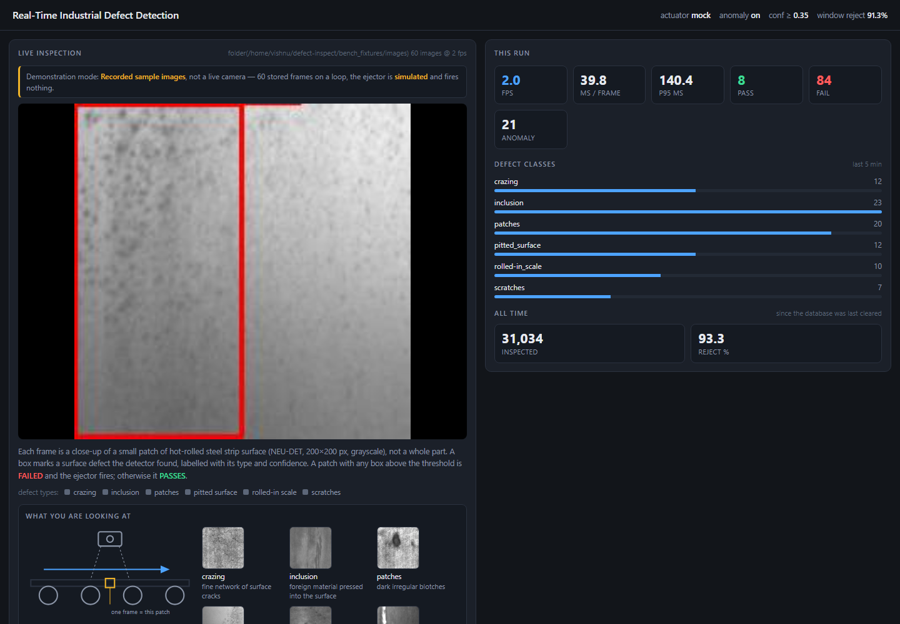
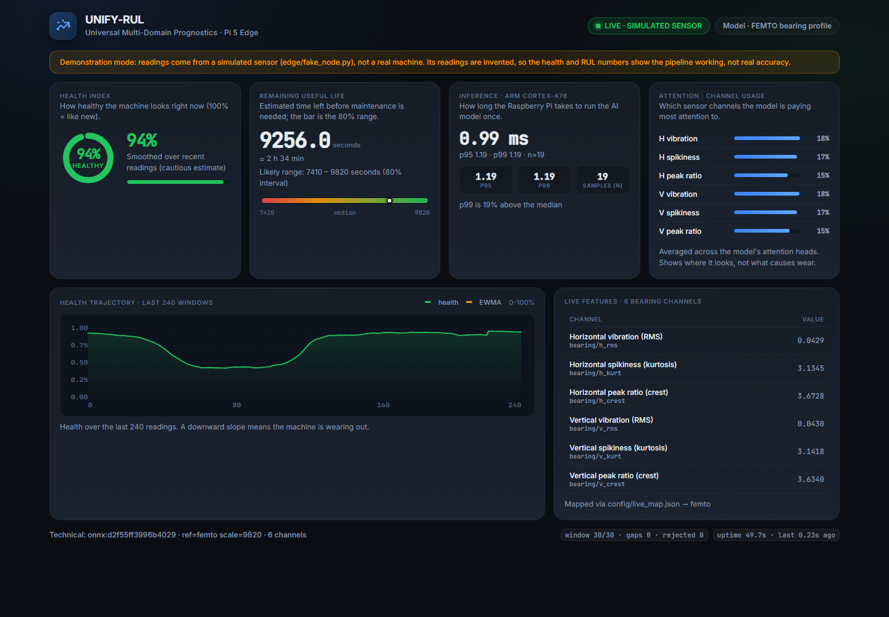
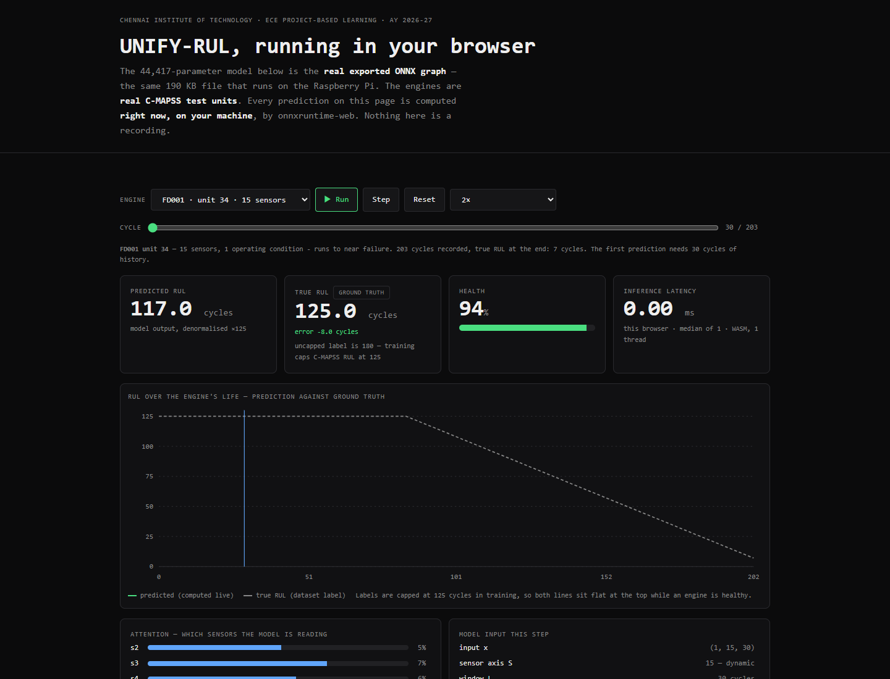

# defect-pi

Everything that lives on **defect-pi**, a Raspberry Pi 5 (8 GB, Raspberry Pi OS 12
bookworm, CPU only) that hosts two edge-AI demos built for ECE Project Based
Learning at Chennai Institute of Technology. Only one demo runs at a time, and
nothing starts on boot.

| Demo | What it does | Port | Folder |
|------|--------------|------|--------|
| **Defect Inspection** | YOLOv8n (INT8 ONNX) + PatchCore anomaly check on steel-surface images, simulated ejector, SQLite log, live dashboard | `:5000` | [`defect-inspect/`](defect-inspect/) |
| **UNIFY-RUL** | 44k-parameter remaining-useful-life model that accepts any number of sensors, fed by a simulated bearing sensor, live dashboard | `:8000` | [`unify/`](unify/) |

## Screenshots

Captured from the Pi on 2026-10-11.

### Defect Inspection dashboard (`http://defect-pi.local:5000`)



Recorded NEU-DET sample frames on a loop. Each frame is a 200×200 patch of
hot-rolled steel; any box above the confidence threshold fails the part.

### UNIFY-RUL edge dashboard (`http://defect-pi.local:8000`)



Health index, remaining useful life with an 80% interval, on-device inference
latency on the Cortex-A76, and which sensor channels the attention layer reads.
Readings come from `edge/fake_node.py`, a simulated sensor.

### UNIFY-RUL in the browser ([`unify/site/`](unify/site/))



The same exported ONNX model running in the visitor's browser through
onnxruntime-web over real C-MAPSS test engines. It needs HTTP, not `file://`,
and expects the model next to it:

```bash
cp unify/edge/artifacts/unify_rul.onnx unify/site/assets/
cd unify/site && python -m http.server 8080
```

## Layout

```
defect-inspect/        defect detection project (its own README, docs, reports, paper)
unify/                 UNIFY-RUL project (its own README, docs, firmware, site)
unify-rul-edge/        older edge-only copy of UNIFY-RUL, superseded by unify/
bin/demo               start / stop / status for the demos, with a verified stop
Desktop/               desktop launchers on the Pi
.config/systemd/user/  the systemd --user units the launchers start
backups/               dashboard backup from 2026-09-28
docs/images/           the screenshots above
```

## Running the demos on the Pi

```bash
ssh vishnu@defect-pi.local
demo start defect-inspect   # or: demo start unify-rul  (stops the other one first)
demo status
demo stop                   # stops everything and checks no process or port survived
```

Each project's README covers setup from scratch (virtualenv, models, training).

## Notes on this snapshot

- `defect-inspect` and `unify` each also have their own repository:
  [defect-inspect](https://github.com/Vishnu-3727/defect-inspect) and
  [unify-rul](https://github.com/Vishnu-3727/unify-rul). This repo is a flat
  snapshot of the Pi's home directory, without their git history.
- Virtualenvs, caches, runtime SQLite databases, datasets and old model
  snapshots are left out, following each project's own `.gitignore`.
- The ESP32 firmware config ships with `CHANGE_ME` for the WiFi credentials.
  Fill them in locally and do not commit them.
