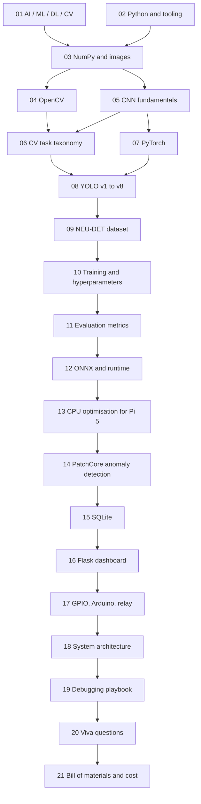

# 00 — Start Here

This folder is the whole course for the project **Real-Time Industrial Defect
Detection System Using Deep Learning and Computer Vision**.

It assumes you know nothing beyond basic programming. Every module teaches its
own prerequisites, in order. If a module says "you need 03 first", read 03
first — the order is not decoration, it is a dependency graph.

---

## What the system actually does

A steel component travels on a conveyor. A camera photographs it. A neural
network decides whether the surface has a defect. If it does, a solenoid kicks
it off the belt, and the result is written to a database that a web dashboard
displays.

```
 conveyor  ──►  [ camera ]  ──►  [ Raspberry Pi 5 ]  ──►  [ Arduino ] ──► [ relay ] ──► [ solenoid ]
                                      │                                                      │
                                      ▼                                                      ▼
                                 [ SQLite ]                                          defective part
                                      │                                              leaves the belt
                                      ▼
                                [ dashboard ]
```

Every arrow in that picture is explained line by line in
[18_system_architecture.md](18_system_architecture.md).

---

## Reading order and dependency graph



| # | Module | Read it to understand |
|---|--------|----------------------|
| 01 | AI, ML, DL, CV | What kind of problem this is, and why classical code cannot solve it |
| 02 | Python and tooling | Why Python, virtual environments, the repo layout |
| 03 | NumPy and images | What an image *is* to a computer |
| 04 | OpenCV | Reading cameras, resizing, colour spaces, drawing boxes |
| 05 | CNN fundamentals | Convolution, pooling, activation, why they beat hand-written rules |
| 06 | CV task taxonomy | Classification vs detection vs segmentation, and which one we need |
| 07 | PyTorch | Tensors, autograd, training loops, transfer learning |
| 08 | YOLO v1 to v8 | The detector itself: backbone, neck, head, NMS, IoU, model sizes |
| 09 | NEU-DET dataset | The six defect classes, VOC format, splits, augmentation |
| 10 | Training | Epochs, batch size, learning rate, loss, overfitting |
| 11 | Evaluation metrics | Precision, recall, F1, mAP, confusion matrix |
| 12 | ONNX and runtime | Why we export, and how inference runs without PyTorch |
| 13 | CPU optimisation | Quantisation, threads, the actual latency budget |
| 14 | PatchCore | Unsupervised anomaly detection, and its honest limits |
| 15 | SQLite | Storing every inspection result |
| 16 | Flask dashboard | Live video streaming and reporting in a browser |
| 17 | GPIO and Arduino | Electrical control of the ejector |
| 18 | System architecture | Every module, every arrow, every data type |
| 19 | Debugging playbook | The bugs this project will actually produce |
| 20 | Viva questions | Predicted questions with answers |
| 21 | Bill of materials | Every component, alternatives, cost vs performance |

---

## How each module is structured

Every module follows the same ten sections, so you always know where to look:

1. **Concept** — the idea in plain words
2. **Why it is needed** — what breaks without it
3. **Real-world example** — usually from manufacturing
4. **How it works** — the mechanism
5. **Mathematical intuition** — only where the maths carries meaning
6. **Software implementation** — the code in this repo that does it
7. **Hardware implementation** — what it means on the Pi or the Arduino
8. **Common mistakes** — including the ones we hit
9. **Interview / viva questions** — with answers
10. **Summary** — the five lines worth memorising

---

## Glossary, in one place

| Term | Meaning in one sentence |
|------|------------------------|
| **Inference** | Running a trained model on new data to get a prediction |
| **Training** | Adjusting a model's weights so its predictions match known answers |
| **Epoch** | One complete pass of the training set through the model |
| **Batch** | The group of images processed together before weights update once |
| **Weights / parameters** | The numbers inside the network that get learned |
| **Tensor** | A multi-dimensional array; an image is a 3-D tensor |
| **Bounding box** | A rectangle `(x, y, width, height)` marking where an object is |
| **Confidence** | The model's own estimate, 0 to 1, that a detection is real |
| **IoU** | Intersection over Union: how much two boxes overlap, 0 to 1 |
| **NMS** | Non-Maximum Suppression: deleting duplicate boxes for one object |
| **mAP** | mean Average Precision: the standard accuracy score for detectors |
| **Backbone / neck / head** | The three stages of a detector: features, fusion, prediction |
| **ONNX** | A portable file format for a trained model, readable without PyTorch |
| **Quantisation** | Storing weights as 8-bit integers instead of 32-bit floats, for speed |
| **Latency** | Time for one frame, in milliseconds |
| **Throughput / FPS** | Frames finished per second |
| **Anomaly detection** | Flagging "not normal" without having been taught what defects look like |
| **GPIO** | General Purpose Input/Output: the Pi's controllable pins |
| **Actuator** | Anything that turns an electrical signal into physical motion |

---

## What you need before Module 01

Nothing. Start reading.

To *run* the code you need the repo set up, which is Module 02.
