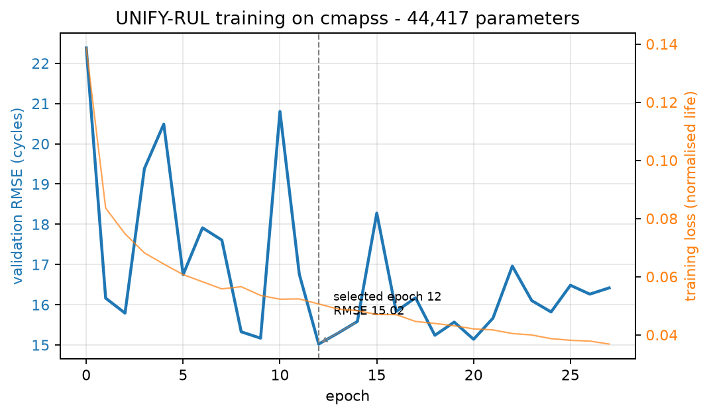
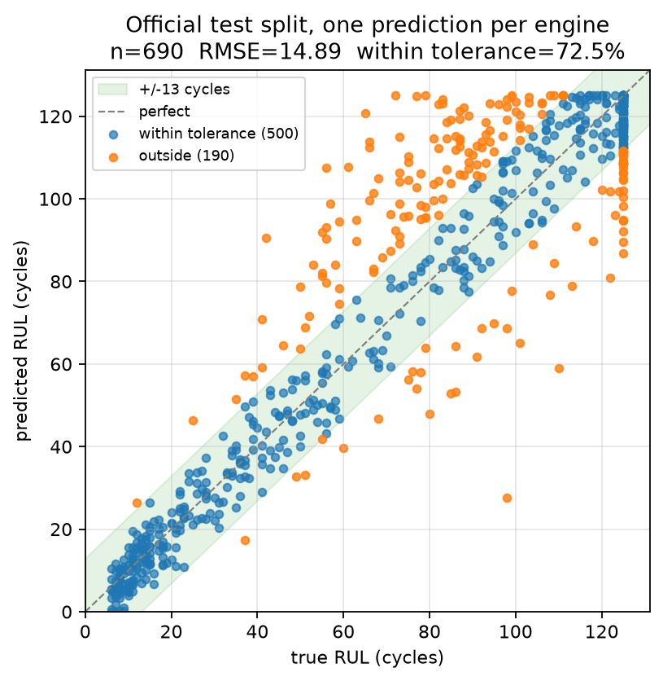
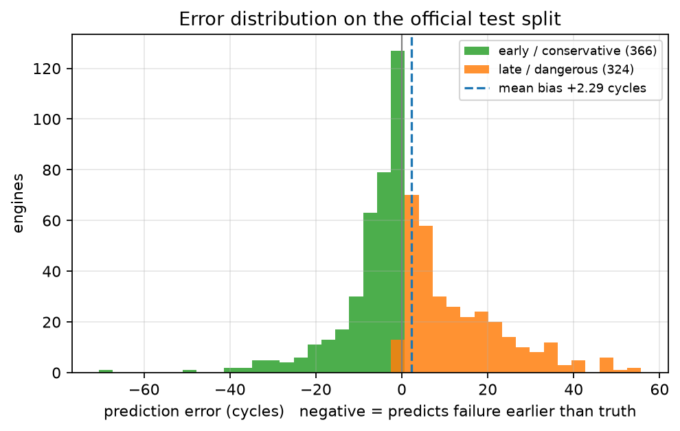
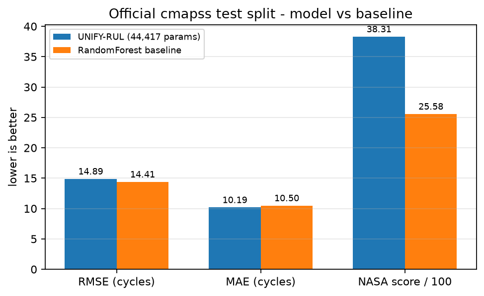
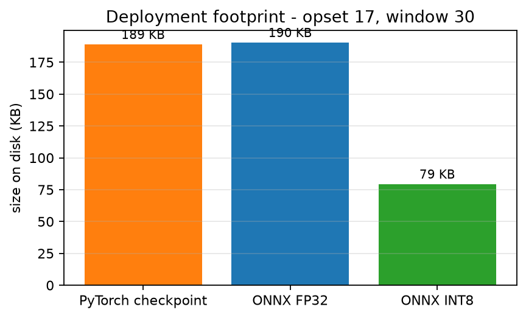
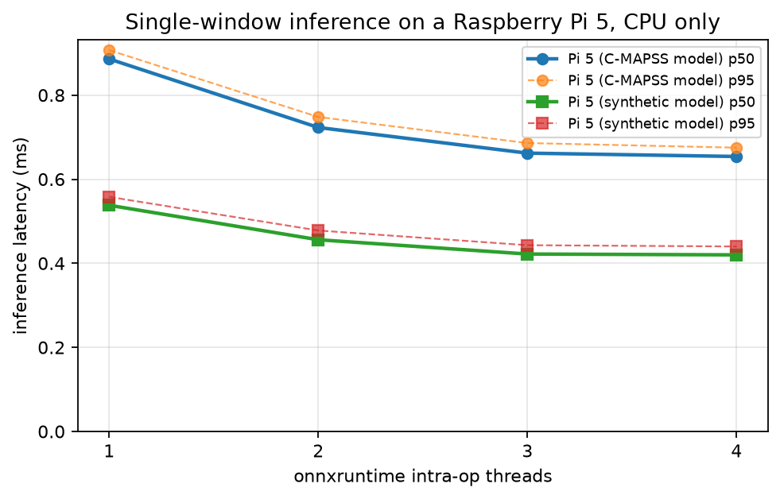
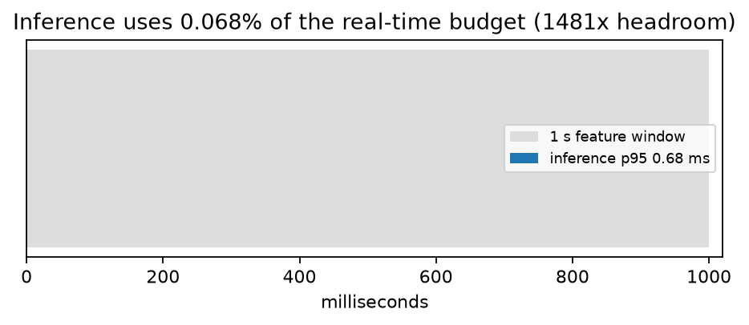
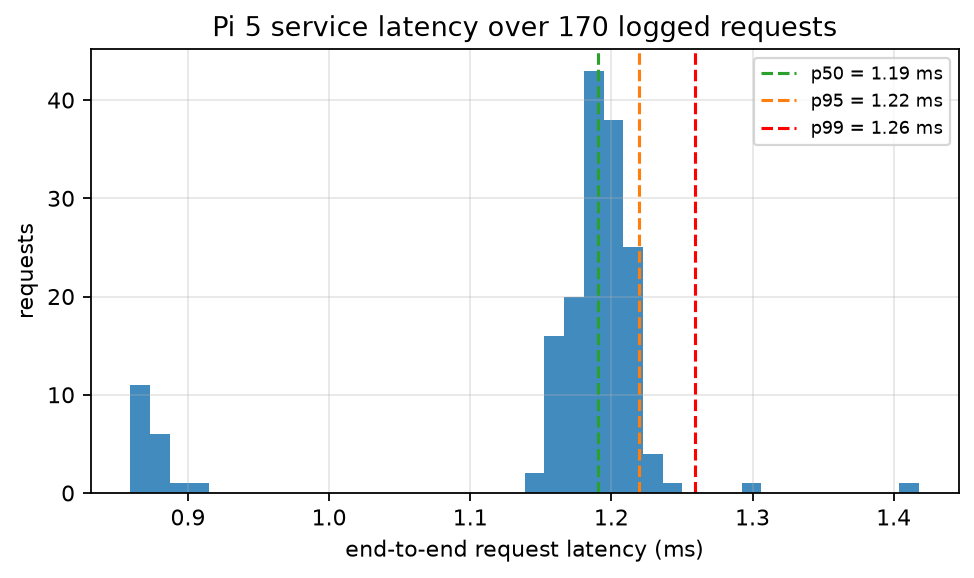
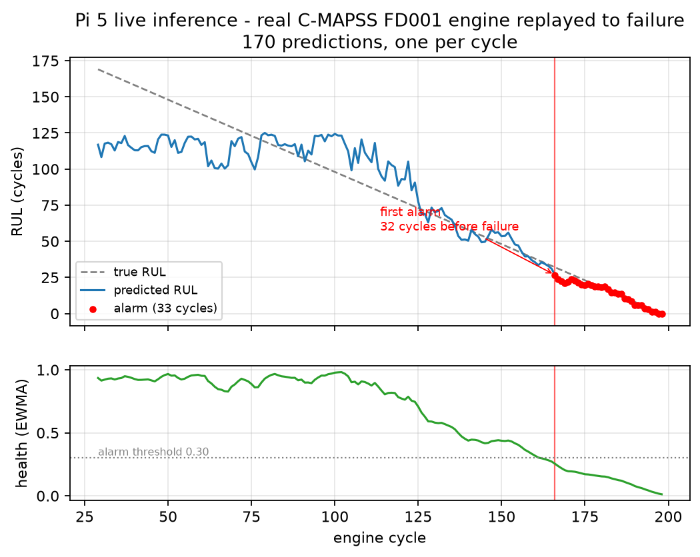

# UNIFY-RUL — full test and validation report

**Date:** 2026-08-28
**Target hardware:** Raspberry Pi 5 Model B Rev 1.1, 4 cores, 8 GB, `defect-pi.local`,
kernel `6.12.93+rpt-rpi-2712-aarch64`, onnxruntime 1.20.1, CPU execution provider only.
**Training host:** Windows 11, torch 2.13.0+cu130, onnxruntime 1.28.0.
**Model under test:** `sha256 a80c367e596a6517…32a8f6`, 44 417 parameters, opset 17,
window 30, trained on real C-MAPSS (all four FD subsets).

Every number below was measured on 2026-08-28 by the commands in
[§9](#9-how-to-reproduce). Nothing is quoted from a previous run, and no figure is
drawn from a hand-typed value — `scripts/make_report_figures.py` parses each one out
of the artifact that produced it.

---

## 1. Headline

| | Result |
|---|---|
| Test suite | **61 passed, 0 failed** (`pytest tests/ -q`) |
| Capacity check | overfit 8 samples → max abs error 0.00030 normalised life, **PASS** |
| Official C-MAPSS test split | **RMSE 14.89 cycles**, MAE 10.19, NASA score 3831, n = 690 engines |
| Within ±13 cycles | **72.5 %** of held-out engines |
| ONNX export fidelity | max abs difference vs PyTorch **0.000** cycles |
| INT8 quantisation cost | **+0.044 cycles RMSE (+0.29 %)** for 2.4× smaller |
| Pi 5 inference latency | **p50 0.654 ms, p95 0.675 ms** @ 4 threads, 15 sensors |
| Pi 5 end-to-end service latency | **p50 1.19 ms, p95 1.22 ms**, 170 logged requests |
| Live run-to-failure replay | predicted RUL **0.0** at true end of life; alarm fired **32 cycles early**, **0 false alarms** |
| Defects found | **1 critical (fixed and verified)**, 2 open — see [§7](#7-defects) |

The critical defect is the important part of this report: the Pi was returning
**RUL 65.1 for an engine that had already failed**, from the same checkpoint that
returned 0.0 offline. Root cause, fix and hardware verification are in
[§7.1](#71-critical-fixed--the-edge-service-normalised-with-the-wrong-statistics).

---

## 2. What was tested

The whole stack was rebuilt from raw data, not re-verified from cached artifacts:

```
data/raw/cmapss (44 MB, 4 FD subsets)
  -> unify.datasets.build --force        1416 units, 265 256 timesteps, 15 sensors
  -> unify.train.train --overfit         capacity check
  -> unify.train.train                   28 epochs, early stop
  -> unify.train.baseline_rf             RandomForest reference
  -> unify.deploy.export_onnx --quantize FP32 + INT8, parity-verified
  -> scripts/eval_onnx.py                accuracy re-measured after quantisation
  -> scp to defect-pi.local              artifacts + service + config
  -> edge/bench.py --sweep               latency on a quiet Pi
  -> fake_node.py --replay               a real engine, healthy to failure
  -> pytest tests/                       61 tests
```

C-MAPSS is the only real dataset present. `data/raw/femto` and `data/raw/xjtu` are
not downloaded, so the "universal, three-dataset" claim in the project title is
**not exercised by this report** — see [§8](#8-what-this-report-does-not-cover).

---

## 3. Model accuracy



Training ran 28 epochs and early-stopped after 15 without improvement. Epoch 12 was
selected on validation RMSE (15.02 cycles); validation loss is noisy from epoch 13
onward, which is what triggered the stop.



One prediction per held-out engine on the official `test_FDxxx.txt` split — the same
files every published C-MAPSS RMSE is measured against. 500 of 690 engines land
within ±13 cycles. The vertical stack at true RUL = 125 is the piecewise RUL cap:
every engine still in its healthy phase carries the same label, so the model cannot
be graded there and should not be.



Error sign matters more than magnitude in maintenance: an *early* prediction wastes a
service slot, a *late* one lets the machine fail. The distribution is close to
symmetric, which is honest but not ideal — `loss.kind: pinball` plus alarming on the
10th percentile is the implemented-but-unused lever for biasing it conservative.

### Against a classical baseline



| | RMSE ↓ | MAE ↓ | NASA ↓ |
|---|---|---|---|
| UNIFY-RUL, 44 417 params | 14.895 | **10.188** | 3831 |
| RandomForest, 105 engineered features | **14.405** | 10.497 | **2558** |

**The RandomForest wins on RMSE and on the NASA score.** State this plainly rather
than burying it. On a single dataset with good hand-built features, a 44k-parameter
attention model buys nothing in accuracy. What it buys is what the baseline cannot
do: one set of weights that accepts an arbitrary sensor count, exports to a 79 KB
graph, and runs in 0.65 ms on a CPU-only edge board. A RandomForest of 200 trees over
105 features is neither small nor sensor-count agnostic. The defence of this
architecture is deployability and cross-dataset transfer, not leaderboard RMSE — and
the cross-dataset half is still unproven (§8).

---

## 4. Export and quantisation

`python scripts/eval_onnx.py --tag cmapss_full`, all three evaluated on the identical
official-test windows:

| | RMSE | MAE | NASA | max abs delta vs torch |
|---|---|---|---|---|
| torch FP32 | 14.895 | 10.188 | 3831.3 | — |
| ONNX FP32 | 14.895 | 10.188 | 3831.3 | **0.000 cycles** |
| ONNX INT8 | 14.938 | 10.311 | 3788.9 | 11.368 cycles |

**Quantisation cost: +0.044 cycles RMSE, +0.29 %.** Aggregate accuracy is essentially
untouched. Note the third column: individual engines move by as much as 11.4 cycles
under INT8 even though the aggregate does not. If a per-asset decision threshold is
ever set from an FP32 number, re-derive it on INT8.

Export parity was verified separately across sensor counts S ∈ {2, 10, 14, 21}
(max abs diff 1.19e-07), batch 8, and with a masked sensor — the dynamic-axis claim
holds.



189 KB PyTorch checkpoint → 190.4 KB ONNX FP32 → **79.3 KB ONNX INT8 (2.4×)**.

---

## 5. Edge performance on the Pi 5

`defect-inspect.service` was stopped for the duration of these measurements — it was
saturating all four cores at 375 % CPU and would have made every number meaningless.
Load average at the start of the sweep was 0.02, SoC 43.9 °C, `get_throttled=0x0`
before and after. The service was restarted afterwards.



| threads | p50 (ms) | p95 | p99 | max |
|---|---|---|---|---|
| 1 | 0.886 | 0.907 | 0.926 | 1.056 |
| 2 | 0.723 | 0.748 | 0.758 | 0.854 |
| 3 | 0.662 | 0.686 | 0.693 | 0.795 |
| 4 | **0.654** | **0.675** | 0.684 | 0.846 |

The 8-sensor synthetic model on the same board is 0.420 ms p50 — latency scales with
sensor count roughly as expected, and the 15-sensor C-MAPSS model costs 56 % more.
Thermals rose 43.9 → 48.8 °C over 4000 inferences with no throttling.



Against a 1 s feature window, inference consumes **0.068 % of the budget — 1481×
headroom**. The bottleneck is the window, not the model, which is the correct
result for an edge system and is what makes a many-node deployment plausible.



End to end through FastAPI — deserialise, window, normalise, infer, persist to
SQLite — is **p50 1.19 ms, p95 1.22 ms, max 1.42 ms** over the 170 logged requests.
The HTTP and storage path costs about 0.5 ms on top of the bare ONNX call.

### INT8 does not run on this Pi

The quantised model loads and runs correctly on x86 with onnxruntime 1.28.0, but on
the Pi's onnxruntime 1.20.1 / aarch64 it fails at session creation:

```
onnxruntime.capi.onnxruntime_pybind11_state.NotImplemented: [ONNXRuntimeError] : 9 :
NOT_IMPLEMENTED : Could not find an implementation for ConvInteger(10) node with name
'/encoder/net/net.0/Conv_quant'
```

The 2.4× size saving is therefore **currently unusable on the target device**. See
[§7.2](#72-open--int8-has-no-kernel-on-the-pis-onnxruntime).

---

## 6. Live run-to-failure test

The strongest evidence in this report. A real C-MAPSS FD001 engine
(`cmapss_FD001_train_u68`, 199 cycles, RUL 198 → 0) was streamed through the deployed
Pi service one cycle at a time, exactly as a sensor node would post it.



- 170 predictions (199 cycles − 30-cycle warm-up + 1), all `status: ok`, zero gaps,
  zero rejected packets.
- Prediction sits at the 125-cycle cap while the engine is healthy, then tracks true
  RUL down the degradation slope. RMSE over the region where the true RUL is inside
  the cap: **11.35 cycles**.
- Final two cycles predict **RUL 0.0** against a true RUL of 1 and 0.
- Alarm first fires at cycle 166 — **32 cycles of warning before failure** — and stays
  on for the remaining 33 cycles.
- **Zero false alarms** in the 137 healthy cycles before that. The EWMA plus
  5-consecutive hysteresis did its job on this unit.

One unit is a demonstration, not a false-alarm rate. A defensible FAR needs the same
replay across a few dozen units.

---

## 7. Defects

### 7.1 CRITICAL, fixed — the edge service normalised with the wrong statistics

**Symptom.** The first live replay ended with the Pi reporting **RUL 65.1** for an
engine at its true end of life, and the alarm never firing (health bottomed out at
0.53 against a 0.30 threshold). The identical checkpoint evaluated offline on the
identical unit returned **RUL 0.00**.

**Root cause.** `edge/inference.py` called
`Normalizer.vector_for(ref_dataset, sensor_ids)` with no operating condition.
`Normalizer._table()` falls back to the **global** statistics when `cond is None`.
C-MAPSS is normalised **per operating condition** during training
(`PER_CONDITION` in `unify/train/train.py`, docs/05 §5.2), because FD002 and FD004
sensor readings move more with condition than with degradation. The two tables
disagree by up to **390 units in the mean and a factor of 1105 in the standard
deviation**. The model received garbage and reported it calmly, with no error, no
warning, and a plausible-looking number.

**Proof.** Feeding the offline model the global statistics reproduces the Pi's answer
to the decimal:

```
condition of last window: 0
global stats  -> RUL 65.10   (Pi service reported 65.10)
per-condition -> RUL  0.00   (offline evaluation reported 0.00)
max |mean_global - mean_cond| = 390.49
max |std_global  / std_cond|  = 1105.32
```

**Fix.** One guard in `Predictor.__init__`, where every caller routes through:
the live map may now carry a `"condition"` field, and a reference dataset whose
statistics are per-condition **refuses to load** without one, naming the valid IDs.
Silence was the danger here, so the fix is a refusal, not a default.
`config/live_map.cmapss.json` sets `"condition": "0"`, and `/health` now reports
`cond=` so the deployed configuration is visible without SSH.

**Verified on hardware.** After redeploying, the same replay ends:

```
196 {"rul":1.0101832449436188,"health":0.0255,"alarm":true}
197 {"rul":0.0,"health":0.0179,"alarm":true}
198 {"rul":0.0,"health":0.0125,"alarm":true}
```

**Regression test.** `tests/test_live_normalisation.py`, 4 tests, no skips: the
refusal fires and names the valid conditions; a configured condition really selects
the conditional mean and std rather than merely loading; non-per-condition datasets
still load; and a fourth test pins the premise that the two tables actually differ,
so the other three cannot pass for the wrong reason.

### 7.2 Open — INT8 has no kernel on the Pi's onnxruntime

`ConvInteger(10)` is unimplemented in onnxruntime 1.20.1 on aarch64 (§5). The FP32
model is what actually ships today. Options, cheapest first: upgrade onnxruntime on
the Pi and re-measure; or quantise with `QOperator`/per-tensor settings that avoid
`ConvInteger`; or accept 190 KB, which is not a constraint on an 8 GB board. Left
unfixed because nothing currently depends on the INT8 path.

### 7.3 Open — `config/live_map.json` points at an untrained dataset

The default live map sets `ref_dataset: "xjtu"`, which has no statistics in any
current `norm_stats.json`, so `Predictor` refuses to start against it. This is the
guard working as intended, but it means the *default* configuration cannot run and
`unify-rul.service` was found `inactive (dead)` and `disabled` on the Pi. Either
train on XJTU or point the default at C-MAPSS.

### 7.4 Resolved observations

- **Stale benchmark.** The Pi's `results/bench.json` recorded
  `model_sha fec9c47f39c2c968`, which matched no artifact on the device — it had been
  measured against a model that was later replaced. Both sweeps in this report record
  the deployed hash (`a80c367e596a6517`, `4cc2a94027bd96e3`) and are traceable.
- **Run-to-run variation.** The previous stored C-MAPSS run reported official test
  RMSE 14.511 / NASA 3417; this rebuild with the same seed 42 gives 14.895 / 3831,
  a 2.6 % difference. Seeding does not make CUDA kernel scheduling deterministic.
  Quote a range, or set `torch.use_deterministic_algorithms(True)` and pay for it.
  The RandomForest baseline reproduced bit-identically, as it should.

---

## 8. What this report does not cover

- **FEMTO and XJTU-SY are not downloaded.** Only C-MAPSS was trained and tested, so
  the "any dataset" claim is untested here. `hold_out_official_test` has no published
  split for XJTU, which changes the protocol when it is added.
- **No live sensor rig.** The MPU-6050 / ESP32 path was not exercised; the replay
  node stands in for it. Per `docs/11`, the rig's 1 kHz ODR against the bearing
  datasets' 25.6 kHz means a live bearing RUL number would be an unvalidated
  transfer regardless.
- **One engine in the live test.** Enough to prove the pipeline and to catch §7.1;
  not enough for a false-alarm rate or a lead-time distribution.
- **No power measurement.** Latency and thermals were measured; watts were not.
- **The Pi's SoC temperature was 43.9 °C at a 20 °C-ish ambient.** A cabinet-mounted
  board will be hotter and may throttle; `get_throttled` was 0x0 throughout here.

---

## 9. How to reproduce

```bash
# laptop
python -m unify.datasets.build --datasets cmapss synthetic synthetic_small --force
python -m unify.train.train    --datasets cmapss --overfit          # capacity check
python -m unify.train.train    --datasets cmapss --tag cmapss_full
python -m unify.train.baseline_rf --datasets cmapss
python -m unify.deploy.export_onnx --ckpt results/cmapss_full/best.pt --quantize
python scripts/eval_onnx.py --tag cmapss_full                        # + --demo
python -m pytest tests/ -q

# pi  (stop anything else using the cores first)
scp edge/artifacts/* edge/*.py config/live_map.cmapss.json vishnu@defect-pi.local:...
ssh vishnu@defect-pi.local 'cd ~/unify/edge && \
  UNIFY_LIVE_MAP=../config/live_map.cmapss.json ../.venv/bin/python bench.py --sweep'

# live replay
scp data/interim/cmapss/cmapss_FD001_train_u68.npz vishnu@defect-pi.local:~/unify/edge/
# start the service with the same UNIFY_LIVE_MAP, then:
ssh vishnu@defect-pi.local 'cd ~/unify/edge && \
  ../.venv/bin/python fake_node.py --replay cmapss_FD001_train_u68.npz --period 0.1'

# figures  (needs reports/pi/{bench_pi.json,bench_synth_quiet.json,unify.db})
python scripts/make_report_figures.py --demo
python scripts/make_report_figures.py --tag cmapss_full
```

Sources for every figure: `results/cmapss_full/metrics.json`,
`results/cmapss_full/onnx_eval.json`, `results/baseline_rf.json`,
`reports/pi/bench_pi.json`, `reports/pi/bench_synth_quiet.json`,
`reports/pi/unify.db`. The Pi's pre-change state is archived at
`C:\Users\vishn\Downloads\unify-rul-pi-2026-08-28\` for rollback.

## 10. Files added or changed by this test pass

| File | Why |
|---|---|
| `edge/inference.py` | the §7.1 fix — condition-aware normalisation, refuses to guess |
| `edge/app.py` | `/health` now reports the active condition |
| `config/live_map.cmapss.json` | new — a live map that matches a C-MAPSS-only export |
| `tests/test_live_normalisation.py` | new — 4 regression tests for §7.1 |
| `scripts/eval_onnx.py` | new — the post-quantisation accuracy measurement `export_onnx` asks for |
| `scripts/make_report_figures.py` | new — regenerates all 9 figures from measured files |
| `reports/figures/*.png` | 9 figures |
| `reports/pi/*` | the Pi's benchmarks and live prediction log |
| `results/cmapss_full/` | checkpoint, metrics, ONNX evaluation, per-engine predictions |
